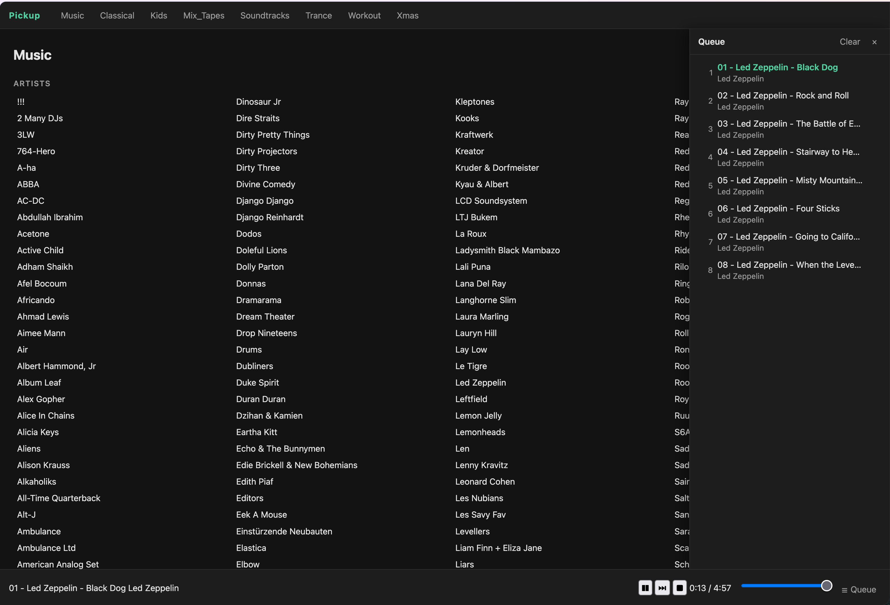

# Pickup

[](https://github.com/werkshy/pickup/actions/workflows/rust_ci.yaml)

This is pickup, a web-based music player with both jukebox (playing on the
server) and browser playback modes. It's designed to offer quick navigation over
a large music directory, and be quick to index the collection by just treating
it as a set of folders in a filesystem. The filesystem it's designed to work
with is just a collection of artist folders that contain albums or bare tracks,
but we also support categories, which are just top-level folders that start with
an underscore.

```
- /path/to/music
  - _Category
    - Category Artist 1
      - Album A
- Artist 2
  - Album B
  - Album C
- Artist 3
  - Album D
    - CD 1
    - CD 2
  - Track X.mp3
```

The collection is indexed once - for me, 40,000 tracks on a CIFS mount
bind-mounted into a Docker container can be indexed in about 20s - and then
cached. The web UI is server-rendered for speed and simplicity, using htmx to
allow navigating the collection without a hard-reload, while the player
components persist.

## Features:

* Server-side 'jukebox mode' playback
* In-browser playback
* Dense navigation of the collection: list all artists in several columns.
* Any track or folder can be played immediately, added as next in the play
  queue, or added at the end of the play queue.
* Runs on embedded hardware or single-board computers like the Raspberry Pi.

### Screenshot



## Authentication and Security

**There is no authentication!** - pickup is not meant to be run on the open
internet. If you want to do that, protect it with a VPN or an auth proxy.


## Usage

Pickup runs on port 9090 by default.

Start the server (will auto-index if no cache exists):
```
pickup --music-dir=/path/to/music serve
```

Index / refresh the collection:
```
pickup --music-dir=/path/to/music refresh
```

List the collection:
```
pickup --music-dir=/music list --depth album
```

`depth` can be one of `category`, `artist`, `album`, `disc`, or `track`.

Print OpenAPI specs:
```
pickup openapi
```

### Refreshing the collection

Pickup automatically re-indexes the current music directory every night, or
there's a button to trigger a refresh if need to update.

### Docker

Images are published to GitHub Container Registry: `ghcr.io/werkshy/pickup`.

**Using the Published Image**

Example docker-compose snippet:

```yaml
services:
  pickup:
    image: ghcr.io/werkshy/pickup
    container_name: pickup
    restart: unless-stopped
    user: 1000:1000
    volumes:
      - "/data/music:/music:ro"
      - "./pickup/cache:/cache"
    ports:
      - 9090:9090
    # Uncomment this to expose the host's sound device for jukebox mode playback
    # devices:
    #   - /dev/snd:/dev/snd
    # group_add:
    #   - audio
```

**Environment variables**

| Variable       | Default               | Description                                            |
|----------------|-----------------------|--------------------------------------------------------|
| `MUSIC_DIR`    | `/music` (container)  | Root of the music collection; overridden by bind mount |
| `CACHE_DIR`    | `/cache` (container)  | Directory for the music file cache; overridden by bind mount |
| `PORT`         | `9090`                | HTTP server port                                       |
| `REFRESH_HOUR_UTC` | `6`               | Hour (UTC) the nightly collection refresh runs         |
| `RUST_LOG`     | (unset)               | Filter; defaults to `info,symphonia_bundle_mp3=warn`  |

**Permissions**

The compose service runs as UID/GID 1000 by default. The `./cache` bind mount
must be writable by that user. Override with `PUID`/`PGID` e.g.
`user: "${PUID:-1000}:${PGID:-1000}"`.

## Background

Pickup is my white whale... I've been playing with the idea since 2007. I have
a large music collection, and my navigation of choice is by album, with easy
search available. The "albums" interface in old Google Play Music (web) was
pretty close, but the uploader never worked for me and now the product is dead.
Pickup has been through several iterations, now it's a Rust API backend that
can play jukebox-style on the server, and I'm working towards browser playback
too.

I've written functional prototypes of this in C++, Python, C++ again (I was
trying to run it on an NSLU2 embedded Linux machine with 32MB RAM), Go/React,
and now Rust with htmx. It started off as a standalone player, then grew an
xmms2 backend, then became an mpd client, and now has its own built-in playback
engine. I'm writing it in Rust because I want it to be fast, run on low-powered
systems like Raspberry Pi, and I am enjoying learning more Rust.

### Design Requirements

- ✅ Run on embedded hardware - any tiny board that runs Linux would be nice, Raspberry
  Pi would be fine.
- ✅ Display results quickly even when the music is stored on a slow-ish network
  drive (i.e. some caching of available music).
- ✅ Assumes /some/nested/path/Artist/Album/Track.extension file format
- ✅ Must have: play now / add to main playlist
- ✅ Must have: responsive frontend, single-page-app feel.
- Include metadata (related artists, photos, album covers, etc).
- Show random albums to play. Shuffle-by-album.
- Must have: play internet streams (e.g. DI Radio)

## Development

Set up a rust toolchain e.g. `rustup toolchain install`

Set up playwright:
```
cd e2e
npm install
npx playwright install chromium
```

### Run tests

```
cargo test
cd e2e && npm test
```

### Docker Development

A `docker-compose.yml` is included. By default it mounts `./music` read-only at `/music`
and `./cache` at `/cache`, and serves on port 9090.

### Version stamping

Release builds are stamped with their git tag: the build script reads
`PICKUP_VERSION`, then a `VERSION` file, then the exact tag at `HEAD`, and
falls back to the crate version otherwise. The Docker build accepts
`PICKUP_VERSION` as a build argument. The stamped version is returned by
`GET /hello` and shown in the header's home-link tooltip.
